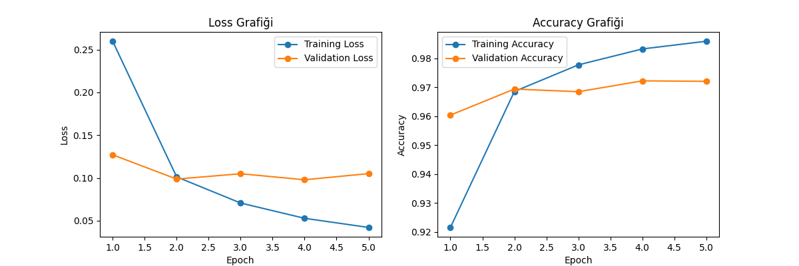
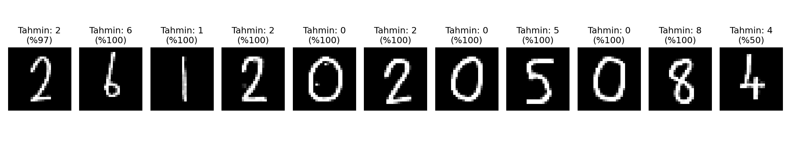

# MNIST Veri Seti ile MLP Tabanlı El Yazısı Rakam Tanıma

Bu projede, MNIST veri seti kullanılarak sıfırdan bir **Multi-Layer Perceptron (MLP)** modeli geliştirilmiş, eğitilmiş, farklı hiperparametrelerle karşılaştırılmış ve kendi el yazımla yazdığım öğrenci numaram (`26120205084`) üzerinde test edilmiştir.

## 1. Model Mimarisi ve Hiperparametreler
* **Mimari:** Flatten (784) -> Linear (256) + ReLU -> Linear (128) + ReLU -> Linear (10)
* **Loss Fonksiyonu:** CrossEntropyLoss
* **Batch Size:** 64
* **Epoch Sayısı:** 5
* **Veri Ayrımı:** 48.000 Train (%80), 12.000 Validation (%20), 10.000 Test

---

## 2. Deney 1: Temel Model Sonuçları (Adam Optimizer)
* **Learning Rate:** 0.001
* **Training Loss (Son Epoch):** 0.0421
* **Validation Loss (Son Epoch):** 0.1050
* **Training Accuracy:** %98.59
* **Validation Accuracy:** %97.21
* **Test Accuracy:** %97.41
* **Eğitim Süresi:** 213.63 saniye

### Eğitim Grafikleri

---

## 3. Deney 2: Hiperparametre ve Optimizer Karşılaştırması
Farklı optimizasyon algoritmalarının model performansına etkisini incelemek amacıyla **Adam** ve **Momentum destekli SGD** optimizatörleri karşılaştırılmıştır:

| Optimizer | Learning Rate | Eğitim Süresi | Test Accuracy |
| :---: | :---: | :---: | :---: |
| **Adam** | 0.001 | 185.29 sn[cite: 17] | **%97.19** (`0.9719`)[cite: 17] |
| **SGD (+ Momentum 0.9)** | 0.01 | **163.87 sn**[cite: 17] | **%97.47** (`0.9747`)[cite: 17] |

### Hiperparametre Analizi ve Yorumu:
* Yapılan karşılaştırma sonucunda, Momentum içeren **SGD** algoritmasının bu veri setinde ve MLP mimarisinde **Adam** algoritmasına kıyasla hem **daha kısa sürede** tamamlandığı (`163.87 sn` vs `185.29 sn`)[cite: 17] hem de **hafifçe daha yüksek test başarısı** (`%97.47` vs `%97.19`)[cite: 17] elde ettiği gözlemlenmiştir. 
* Adam her ne kadar adaptif öğrenme oranı sayesinde erken epoch'larda hızlı öğrenseging de, SGD+Momentum doğru momentum katsayımıyla lokal minimumlardan kaçınmada ve düzgün bir genelleşme sağlamada oldukça başarılı sonuç vermiştir.

---

## 4. Kendi El Yazısı Öğrenci Numaramın (`26120205084`) Test Edilmesi
Kağıt üzerine kurşun kalemle yazılan öğrenci numarası, OpenCV kütüphanesi ile ön işleme adımlarından (Adaptive Thresholding, Morfolojik Kalınlaştırma, Kütle Merkezine Göre Ortalama) geçirilerek MNIST formatına uyarlanmıştır.

### Tahmin Sonuçları (11/11 Başarı)

* Geliştirilen model kendi el yazımla yazdığım **11 rakamın tamamını (%100 başarıyla)** doğru tahmin etmiştir.
* Rakamların büyük çoğunluğu **%97 - %100** aralığında yüksek güven skoruyla bilinirken, sondaki **`4`** rakamı farklı bir yazı stiline sahip olduğu için **%50** güven skoruyla tahmin edilmiştir.

---

## 5. Genel Değerlendirme ve Distribution Shift
* Model MNIST test kümesinde **%97.47** oranında başarı yakalamıştır[cite: 17].
* Gerçek dünya verisi (kendi el yazımız) ile MNIST veri seti arasındaki **Distribution Shift** (dağılım kayması: kağıt dokusu, kurşun kalem kalınlığı ve insan el yazısı varyasyonları) nedeniyle ilk denemelerde bazı karakterlerde zorlanılmıştır. 
* Doğru ön işleme (preprocessing) ve kütle merkezi hizalaması yapılmadan gerçek dünya verilerinden yüksek başarı beklenemeyeceği, bu projede hem teorik hem de pratik olarak bizzat gözlemlenmiştir.